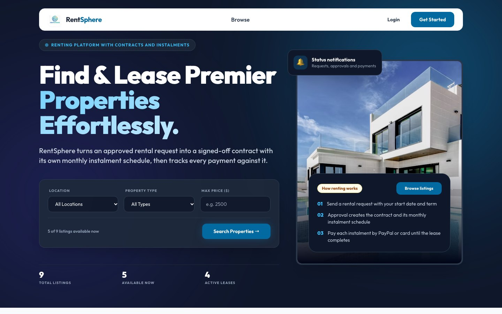
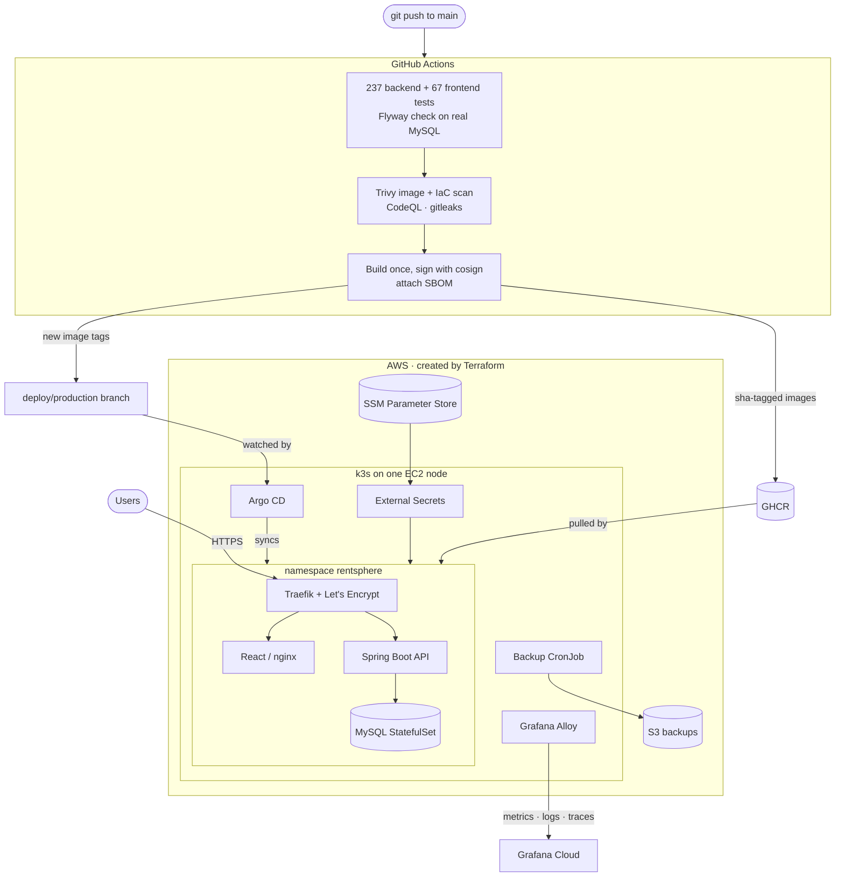
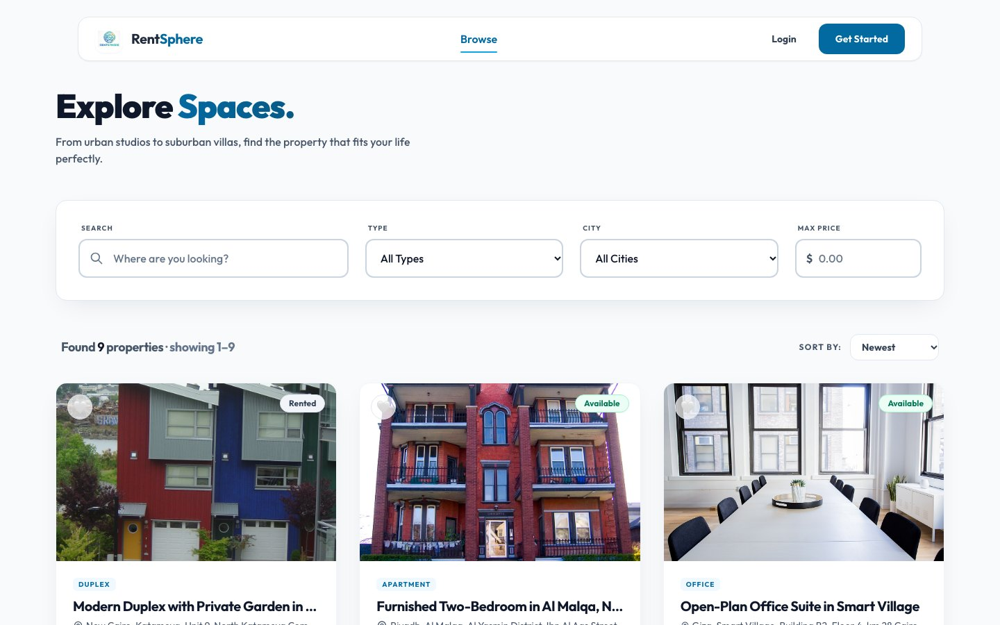
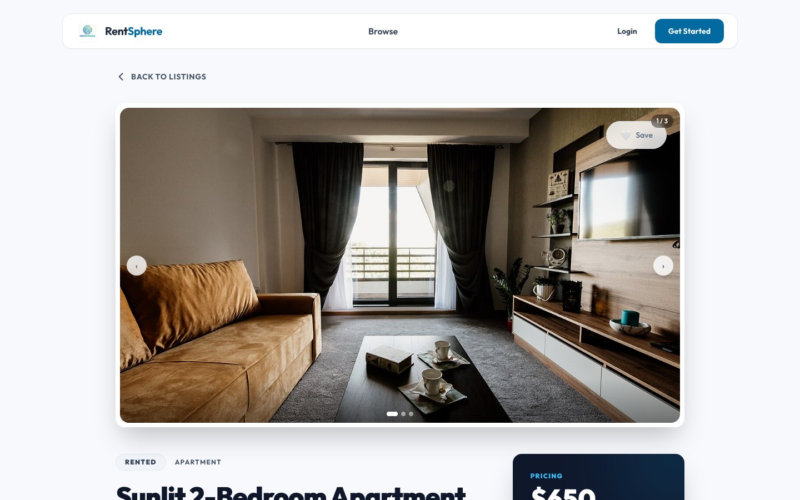
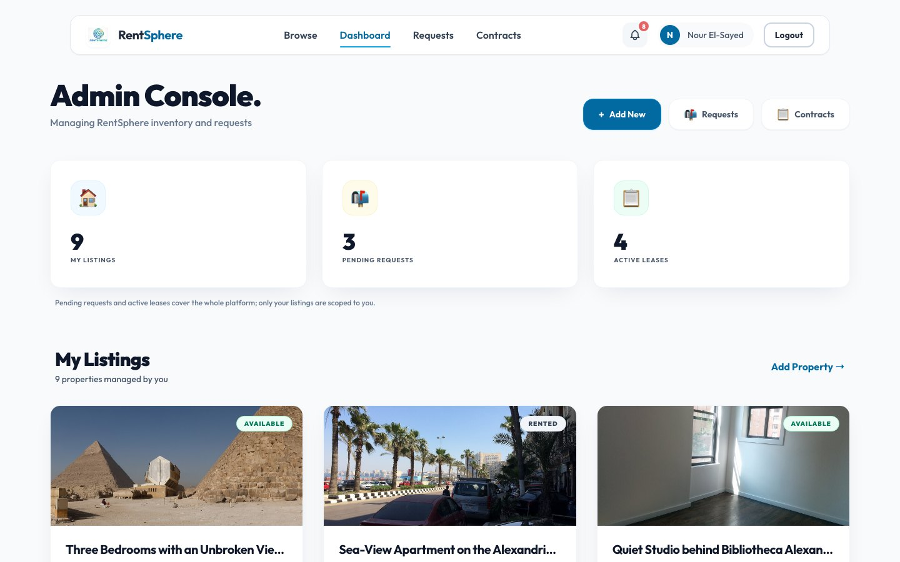
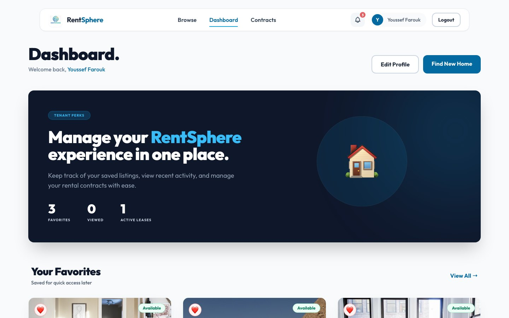
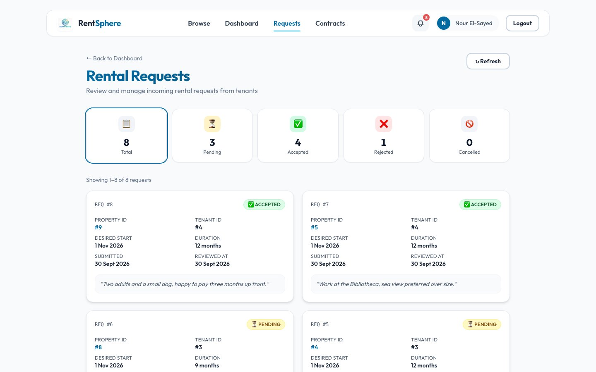
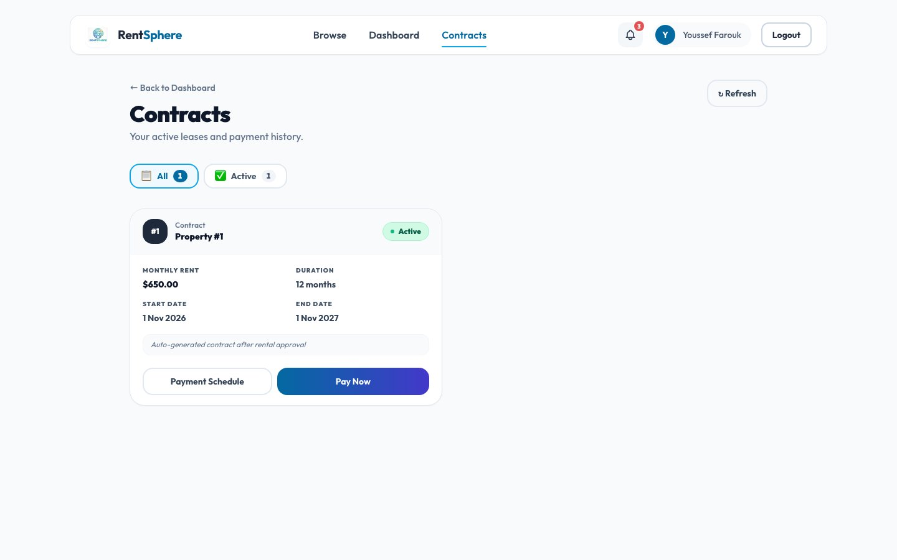

# RentSphere

[](https://github.com/ixi3boda/RentSphere/actions/workflows/ci.yml)
[](https://github.com/ixi3boda/RentSphere/actions/workflows/security.yml)
[](https://github.com/ixi3boda/RentSphere/actions/workflows/terraform.yml)

A rental platform where owners list properties and tenants browse, request a lease and pay
rent monthly. When an owner accepts a request, the backend creates the contract and its full
payment schedule in one transaction.

It also has a full delivery platform around the app: Terraform for AWS, Kubernetes with
GitOps, Prometheus/Grafana/Loki/Tempo observability, supply-chain security in CI, and tested
backups. Everything is sized to run at **$0**.

**Live demo:** https://rentsphere-5jpa.onrender.com
· **API docs (Swagger):** https://rentsphere-api.onrender.com/swagger-ui/index.html

Log in with `nour.elsayed@nilenest.demo` (owner) or `youssef.farouk@mail.demo` (tenant),
password `RentSphereDemo2026`. The demo logins are shared, so their profiles are read-only.
The demo runs on Render's free plan. If the API has gone to sleep, the first request takes
about a minute.

Java 17 · Spring Boot 4.0 · MySQL 8.4 · React · Docker · Kubernetes (k3s, kind) · Kustomize ·
Argo CD · Terraform · AWS · GitHub Actions · Prometheus · Grafana · Loki · Tempo ·
OpenTelemetry · Trivy · CodeQL · cosign



## Architecture



## DevOps

| Area | What is in the repo |
|---|---|
| **Infrastructure as code** | [`infra/terraform`](infra/terraform): VPC, EC2 node running k3s, Elastic IP, IAM, S3 and SSM, split into reusable modules. State lives in a versioned S3 bucket with native locking. GitHub reaches AWS through OIDC, so no access keys are stored. App secrets are write-only and never reach the state file. A $1 budget alarm is the first resource created |
| **Kubernetes** | [`k8s`](k8s): a Kustomize base with `local` (kind) and `aws` overlays. Probes, resource limits, HPA, PodDisruptionBudgets, zero-downtime rolling updates, NetworkPolicies, Pod Security `restricted` (non-root, read-only filesystems, no capabilities). Traefik ingress with per-route rate limits and security headers |
| **GitOps CD** | CI moves the `deploy/production` branch to the new image tags. Argo CD (app of apps, which also manages itself) rolls the change out, and `git revert` on that branch rolls it back. Nothing is built on servers and nobody SSHes in |
| **Observability** | Prometheus metrics from the API on an internal port, with recording rules and 6 alerts (availability, error rate, latency, DB pool, heap, restarts). A provisioned Grafana dashboard (RED, JVM, Hikari, pods). Loki for JSON logs, Tempo for OpenTelemetry traces, with each log line linked to its trace and each span to its logs |
| **DevSecOps** | Trivy fails the build on any fixable HIGH/CRITICAL CVE before an image is pushed. Images get a keyless cosign signature and a signed SPDX SBOM. Trivy misconfiguration scans, CodeQL and gitleaks run on every push and weekly. Every Action is pinned to a commit SHA, and Dependabot keeps 5 ecosystems up to date. Accepted findings are listed with reasons and expiry dates in [`.trivyignore`](.trivyignore) |
| **Database lifecycle** | Flyway migrations, with existing databases baselined in place. CI boots the real jar against MySQL to check that migrations apply from scratch and never re-run. ShedLock keeps scheduled jobs to one replica |
| **Reliability** | Nightly `mysqldump` to S3 with 14-day retention, plus a one-command restore. Restore drill on kind: every listing and payment deleted, then all 9 listings and 45 payments back in 5 seconds |

### What was verified, and where

- **kind:** HPA scaling 2 → 4 API replicas under load. Pod self-healing, and a bad image
  rolled back with `kubectl rollout undo` while the API kept serving. Prometheus scraping
  through the NetworkPolicy. Log lines linked to their Tempo traces. The backup and restore
  cycle
- **Argo CD on a fresh cluster:** the app-of-apps bootstrap, cert-manager and the
  Let's Encrypt `ClusterIssuer`, External Secrets, and Argo CD updating itself from git
- **CI:** both Terraform roots pass `fmt` and `validate`, every Kustomize overlay passes
  `kubeconform` (CRDs included), and the Flyway migrations are applied to MySQL 8.4

### Running on AWS for free

| Choice | Instead of | Saves |
|---|---|---|
| k3s on one `t3.small` | EKS control plane | ~$73/month |
| Public subnets, no NAT gateway | NAT gateway | ~$32/month |
| Traefik on the node's Elastic IP | Application Load Balancer | ~$16/month |
| Grafana Cloud free tier, fed by Alloy | Running Prometheus/Grafana/Loki on the node | memory on a 2 GB node |
| SSE-S3, SSM standard parameters | KMS keys, Secrets Manager | ~$1/key, $0.40/secret per month |

The stack runs at about $20/month, which comes out of the AWS Free plan credits. A Free-plan
account cannot be charged. `terraform destroy` in `environments/production` removes the whole
environment between demos. The bootstrap stack (state bucket, budget alarm, GitHub roles) stays.

## Run it

### Docker Compose

```bash
git clone https://github.com/ixi3boda/RentSphere.git && cd RentSphere
cp .env.example .env          # set the passwords and a JWT secret (32+ chars)
docker compose up --build
```

The app is at http://localhost, behind Nginx. The API creates the schema with Flyway on
startup. To load the demo data:

```bash
set -a; source .env; set +a
docker compose exec -T mysql mysql -u"$MYSQL_USER" -p"$MYSQL_PASSWORD" \
  RentSphereSchema < Backend/src/main/resources/db/seed-demo.sql
```

### Kubernetes on kind

```bash
make kind                 # cluster, Traefik, metrics-server, images, app (demo data included)
make kind-observability   # Prometheus, Alertmanager, Grafana, Loki, Tempo, Alloy
```

The app runs at http://rentsphere.localhost:8088 and Grafana at http://grafana.localhost:8088.
`make kind-monitoring` prints the Grafana password, and `make help` lists every target.

### AWS

```bash
cd infra/terraform/bootstrap && terraform init && terraform apply     # budget, state bucket, GitHub OIDC
cd ../environments/production
terraform init -backend-config="bucket=$(terraform -chdir=../../bootstrap output -raw state_bucket)"
terraform apply           # VPC, node; first boot installs k3s and Argo CD, which deploys the rest
cd ../../.. && make aws-config && git commit -am "Point the AWS overlay at the new node" && git push
```

Argo CD then deploys the app at `https://<elastic-ip>.sslip.io`. To let the Terraform workflow
plan and apply from GitHub, set the bootstrap outputs as the repository variables
`AWS_PLAN_ROLE_ARN`, `AWS_APPLY_ROLE_ARN` and `TF_STATE_BUCKET`.

### Operations

| Task | Command |
|---|---|
| Reach the cluster API (SSM tunnel, no open ports) | `make aws-kubeconfig` |
| Back up now / list backups / restore the newest | `make db-backup` · `make db-backups` · `make db-restore` |
| Restore a specific backup | `make db-restore BACKUP=rentsphere-2026-10-14T023000Z.sql.gz` |
| Roll back a release | `git revert` the release commit on `deploy/production` |
| Shell on the node | `terraform -chdir=infra/terraform/environments/production output -raw shell` prints the SSM command |

## Performance

I seeded 100k listings and 300k images and load-tested the read path with JMeter.

| | Before | After |
|---|---:|---:|
| Avg latency, 50 users | 1,808 ms | 22 ms |
| Search, 50 users | 8,036 ms | 82 ms |
| p95, 100 users | - | 77 ms |
| 200 concurrent users | - | 0% errors, ~120 req/s |

What I changed, all in `PropertyController` and `PropertyRepository`:

- **Paging.** The listing endpoint returned every match (one search sent back 14,286 rows,
  8 MB of JSON). It now uses `LIMIT/OFFSET` with the page size capped at 48.
- **N+1 fix.** Each row used to run its own image query, about 28,500 queries per search.
  Images for a page are now loaded in one batched `WHERE property_id IN (...)` query
  (`buildPropertyDetailsBatch`).
- **Indexes.** I ran `EXPLAIN` on every query the app sends (`Performance/db-benchmark.sql`)
  and dropped the 6 indexes nothing used, 18 → 12.
- **Full-text search.** `LIKE '%term%'` was a full table scan, so search now uses a `FULLTEXT`
  index with `MATCH ... AGAINST`, falling back to `LIKE` on H2 in tests. (Added after the run
  above, not load-tested yet.)

Test plan, seed script, raw results and JMeter screenshots: [Performance/](Performance/README.md)

## Application security

- Stateless JWT auth (24-hour tokens) with BCrypt-hashed passwords and 3 roles (`ADMIN` for
  listing owners, `TENANT`, `VISITOR`). Registration always creates a `VISITOR`
- Least privilege: owner routes need the `ADMIN` role in both the filter chain and
  `@PreAuthorize`, and every query behind them is scoped to the caller. An owner sees only
  the requests and contracts on their own listings, only the tenant on a contract can pay it,
  and no role can read another user's data
- Changing an email or password needs the current password, so a stolen token is not enough
  to take an account over
- Rate limiting at two layers: the ingress (Traefik or Nginx) and the app (15 logins or
  sign-ups, 90 writes, 600 requests a minute per IP), plus a 64 KB cap on request bodies
- Every request DTO is validated against the column it is stored in, and free text rejects
  markup and control characters. Image links must be `https` or a path under `/uploads`
- All SQL is parameterized, sort columns go through a whitelist, and full-text search input
  is reduced to words before it reaches `MATCH ... AGAINST`
- PayPal payments are always created in USD with return URLs on this site, and the captured
  amount and currency are checked before an instalment is marked paid
- CORS only allows the configured frontend origin, errors use one JSON shape and never
  include SQL or stack traces, and HSTS, CSP, `X-Frame-Options`, `X-Content-Type-Options`
  and `Referrer-Policy` are set
- Only the health probes are public. Metrics are served on a separate port that no ingress
  routes to

## Data and transactions

- 8 MySQL tables with foreign keys and `CHECK` constraints on every status/type column,
  versioned with Flyway (`Backend/src/main/resources/db/migration`)
- `UNIQUE (contract_id, installment_no)` so the same instalment can't be paid twice
- Accepting a request is one `@Transactional` call that creates the contract and one payment
  row per month and takes the listing off the market, so it cannot be let twice. Card and
  PayPal payments are transactional too
- A tenant can hold one pending request per listing, only for an available listing that is
  not their own, starting within the next 12 months
- A daily job sends reminders 3 days and 1 day before a due date, marks late instalments
  overdue, cancels contracts that stay unpaid and puts their listings back on the market

## Tests

- 237 backend tests (JUnit 5, Mockito, MockMvc, H2) with a JaCoCo report (~70% lines)
- 67 frontend tests (Jest, React Testing Library, jest-axe)

```bash
cd Backend && ./mvnw test
cd Frontend && CI=true npm test
```

## Features

**Tenants** search by city, district, type and price, save favourites, send rental requests,
and pay instalments by card or PayPal (sandbox). They get notified when a request is reviewed
or a payment goes through.

**Owners** manage listings and photos, accept or reject requests, and track leases and
outstanding payments from an admin dashboard.

| | |
|---|---|
|  |  |
|  |  |
|  |  |

## Project layout

```
Backend/        Spring Boot API, Flyway migrations, tests
Frontend/       React app
k8s/            Kustomize base, local/aws overlays, monitoring and backup components,
                Argo CD apps, platform config
infra/          Terraform: bootstrap, production environment, modules
Database/       100k-row load-test seed
Nginx/          reverse proxy for the Compose stack
Performance/    JMeter plan, EXPLAIN scripts, results
.github/        CI/CD, Terraform, security workflows, Dependabot
Makefile        kind, observability, AWS and backup tasks (make help)
render.yaml     the public demo on Render
```

## Author

Abdelrahman Essam · [LinkedIn](https://www.linkedin.com/in/abdelrahman-essam-a677a6328/) · [GitHub](https://github.com/ixi3boda)
